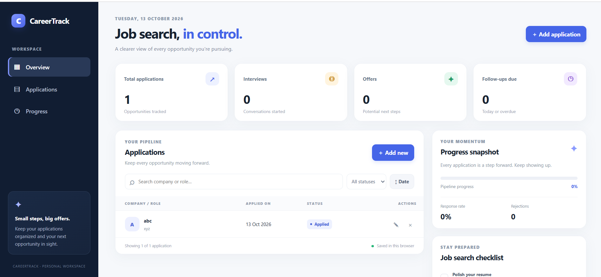
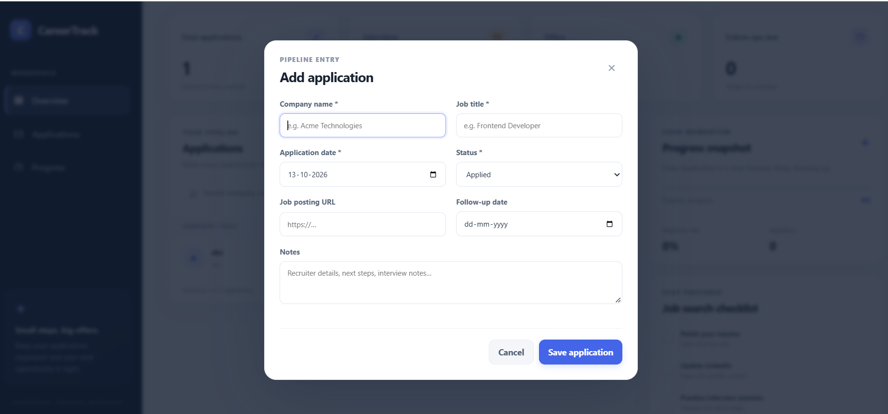

# CareerTrack — Job Application Tracker

A responsive job-search dashboard built with **HTML5, CSS3, and Vanilla JavaScript**. CareerTrack helps job seekers organize applications, track hiring stages, monitor progress, and remember follow-ups.

## 🚀 Live Demo

**[View CareerTrack Live](https://pavani-2116.github.io/CareerTrack/)**

**GitHub Repository:** [Pavani-2116/CareerTrack](https://github.com/Pavani-2116/CareerTrack)

> The live demo link will work after GitHub Pages has been enabled and the site has finished deploying.

## 📸 Screenshots

### Dashboard



The dashboard displays application statistics, the application pipeline, progress insights, follow-up tracking, and the job-search checklist.

### Add Application



The application form allows users to record company names, job titles, application dates, hiring status, job posting URLs, follow-up dates, and notes.

## ✨ Features

- Add, edit, and delete job applications
- Track Applied, Assessment, Interview, Offer, and Rejected stages
- Search by company name or job title
- Filter applications by status and sort by application date
- View dashboard statistics and progress indicators
- Track follow-up dates
- Maintain a personal job-search checklist
- Save data in browser `localStorage`
- Responsive desktop, tablet, and mobile layouts
- Keyboard-friendly dialog and reduced-motion support

## 🛠️ Tech Stack

- **HTML5** — semantic page structure
- **CSS3** — responsive layouts, custom properties, and transitions
- **JavaScript** — ES modules and application functionality
- **LocalStorage API** — browser-based data persistence

## 💻 Run Locally

1. Clone the repository:

   ```bash
   git clone https://github.com/Pavani-2116/CareerTrack.git
   ```

2. Open the `CareerTrack` folder in VS Code.
3. Install the Live Server extension if you do not already have it.
4. Right-click `index.html` and select **Open with Live Server**.

## 📁 Project Structure

```text
CareerTrack/
├── assets/
│   └── images/
├── css/
│   ├── style.css
│   ├── components.css
│   └── responsive.css
├── docs/
│   └── screenshots/
│       ├── dashboard.png
│       └── add-application.png
├── js/
│   ├── main.js
│   ├── app.js
│   ├── storage.js
│   ├── applications.js
│   ├── dashboard.js
│   ├── notifications.js
│   └── utils.js
├── index.html
├── README.md
├── LICENSE
└── .gitignore
```

## 🔒 Data and Privacy

Application records and checklist state are stored in the current browser using `localStorage`. Data is not synced across devices, and the application does not currently have a backend database or user account system.

## 🔮 Future Improvements

- Export and import application data as JSON or CSV
- Add a visual hiring pipeline board
- Add automated tests
- Add optional backend synchronization

## 📄 License

This project is released under the MIT License. See the [LICENSE](LICENSE) file for details.